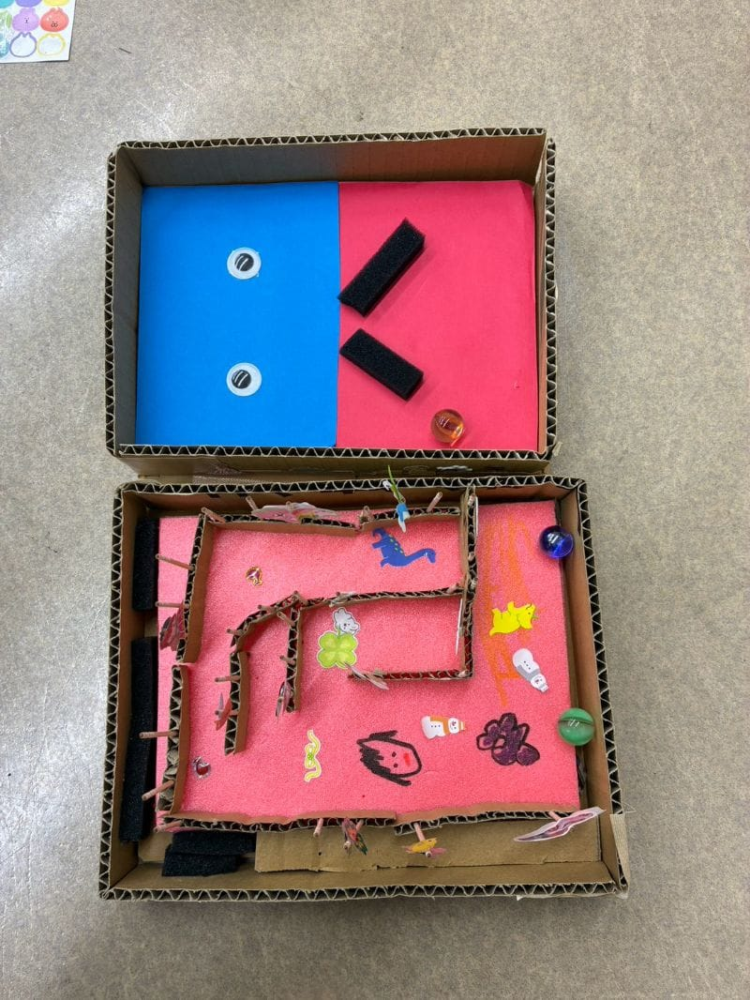
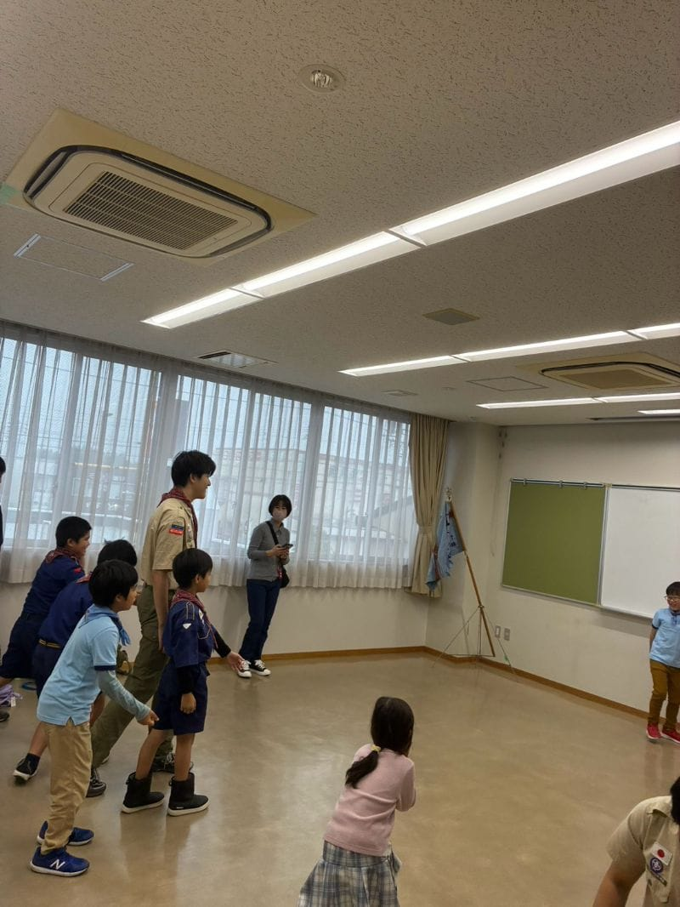
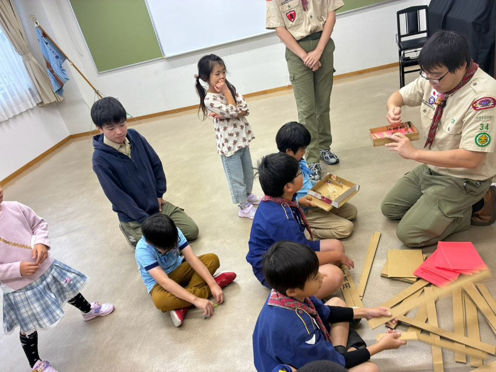
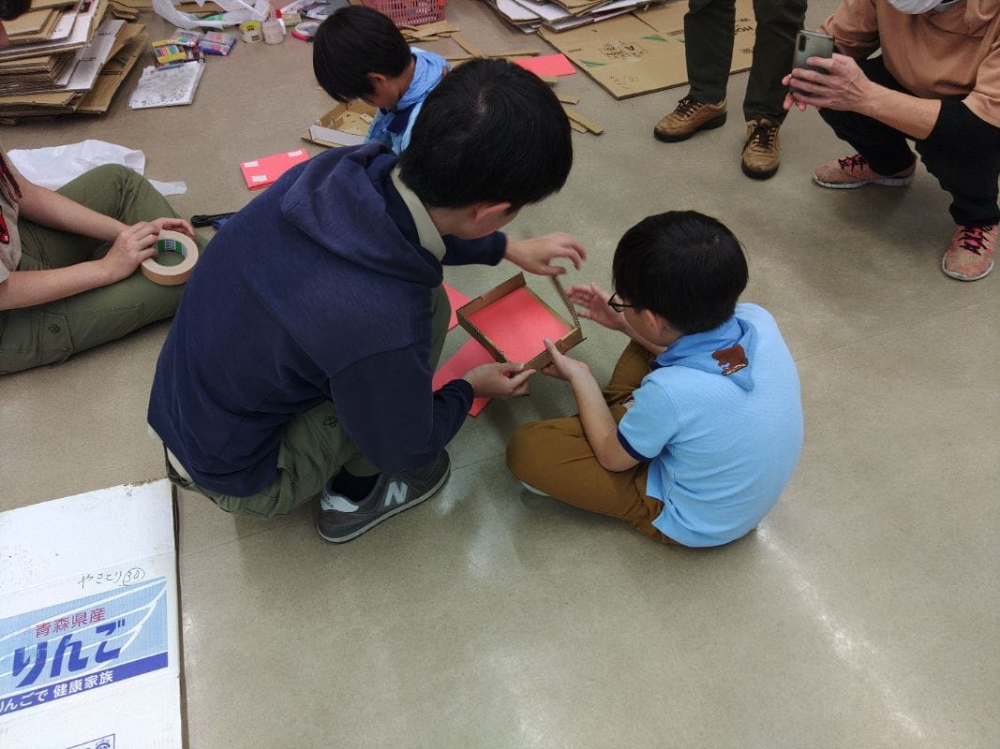
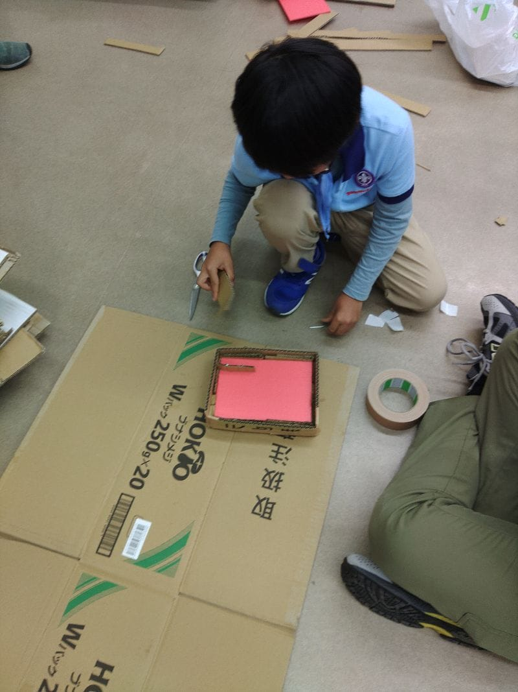
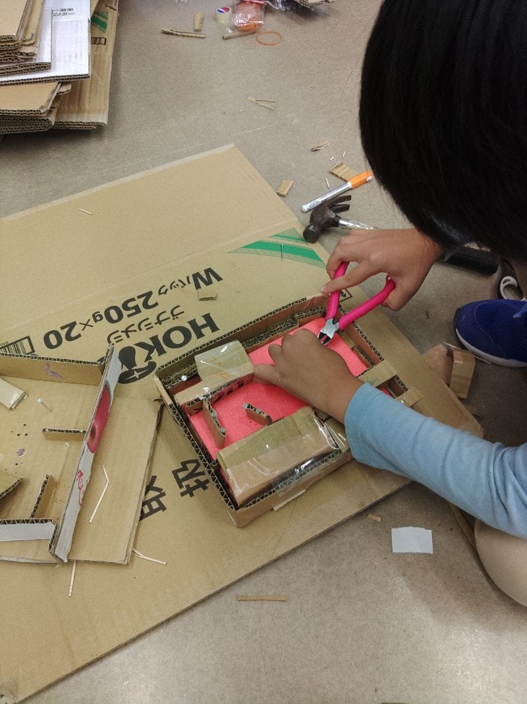
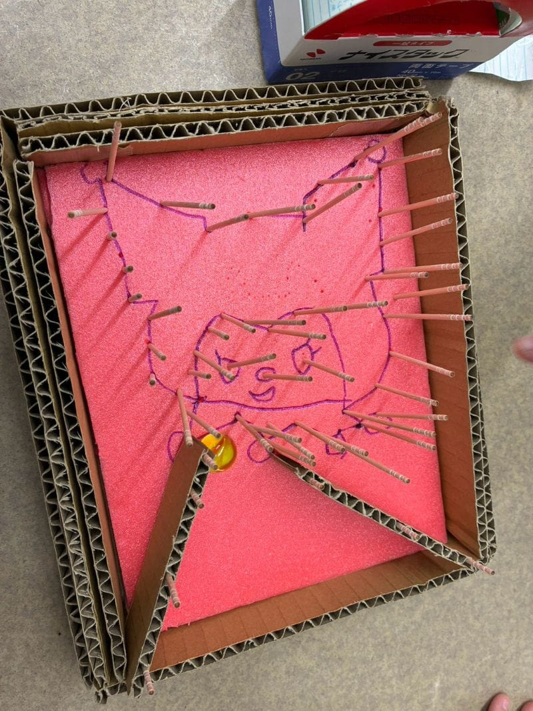
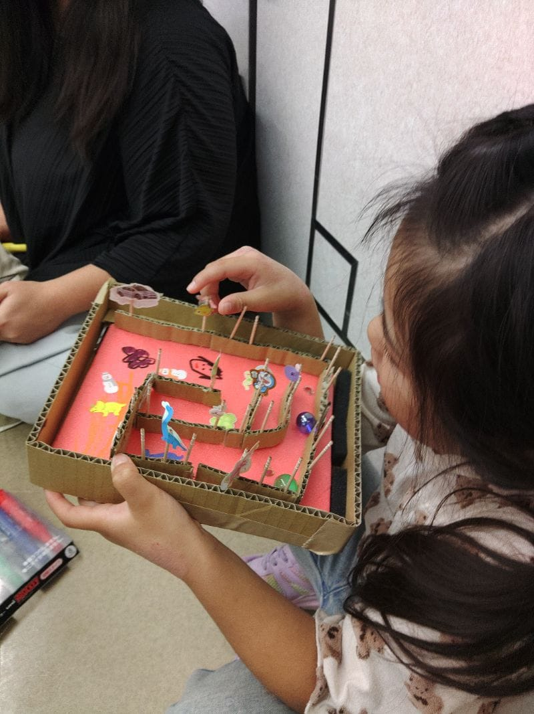
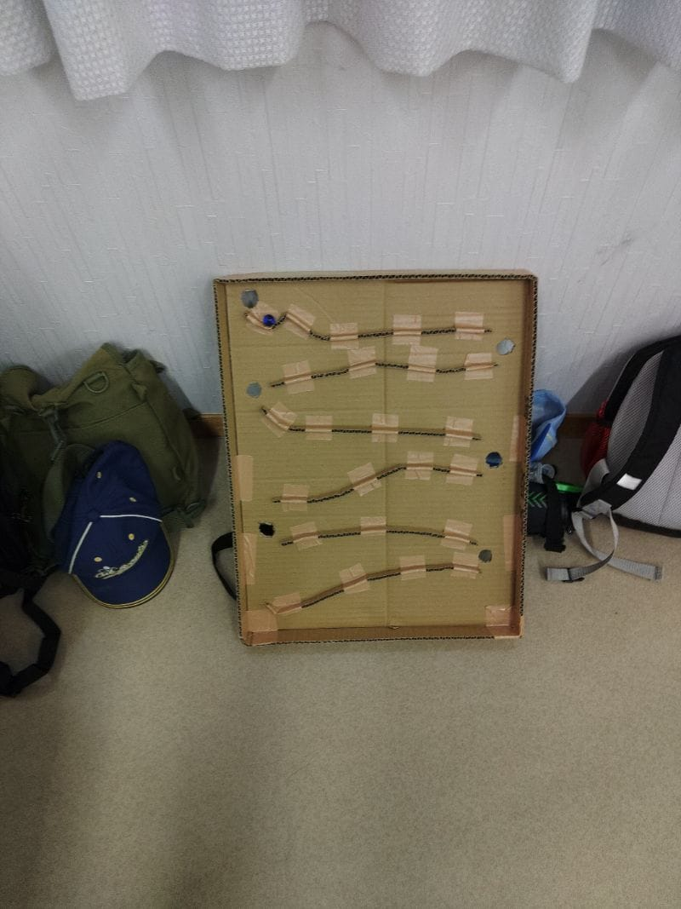
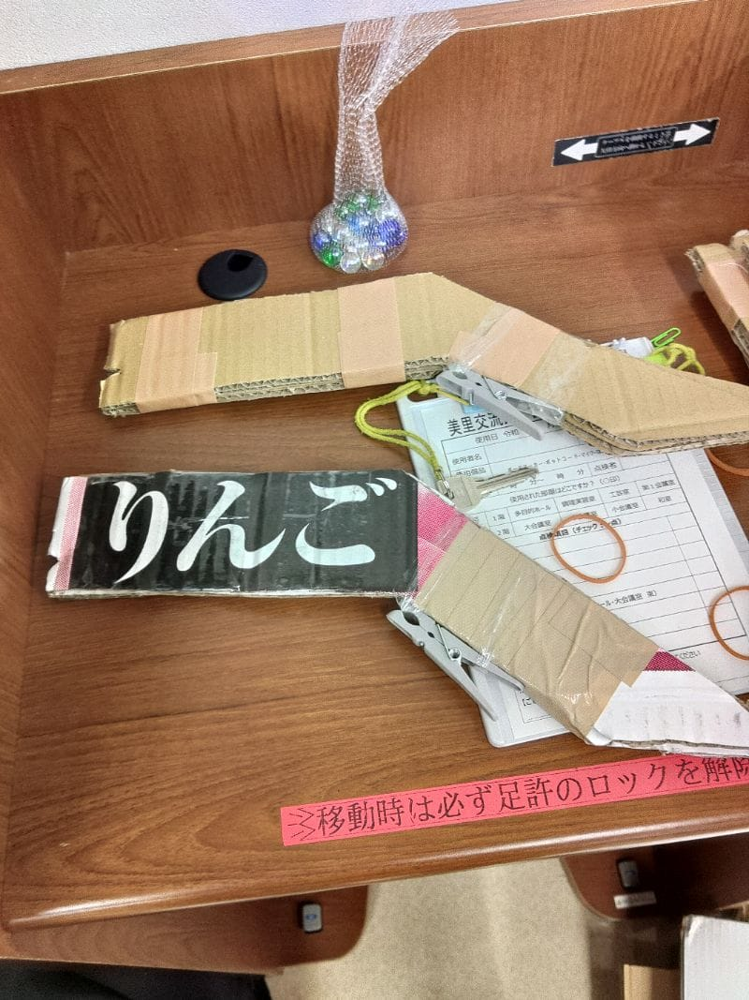

 

まずはみんなでちょっと遊びます。だるまさんがころんだをして体を温めます。

 

さぁ工作の始まりです。段ボール迷路を作るのに隊長の説明を聞いてます。みんないろんな聞き方してますね～

 

段ボールで枠を作ってます。ローバーやカブのお兄さん達に手伝ってもらいながら土台部分を完成させていきます。

 

どんなものにしようか考え中。段ボールを止めるつまようじを一つだけにして動くギミックを編み出してます！

 

こっちはトンネル付きです。隊長では考えなかったことをどんどん出していきます。

 

カブのお兄さんに絵を描いてもらったそうです。うまいですね～

 

つまようじにシールを張り付けてます。とても華やかで良いと思います。

 

これは誰が作ったのかな？すごい大作ですね。

 

なんと実はもう一つ段ボール銃も作る予定でしたがみんな夢中で作りすぎて時間が無くなってしまいました。また今度つくろうね。

 

雨天の中草すべりは出来ませんでしたがみんなとても良い作品と時間を過ごせたと思います。カブのお兄さんも今回はスタッフ側という事で準備とお手伝いをしてもらいました。文句なくちゃんと出来たのは良かったです。今度は楽しい草すべりをしましょうね。
